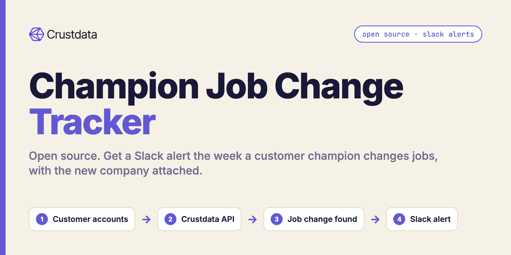
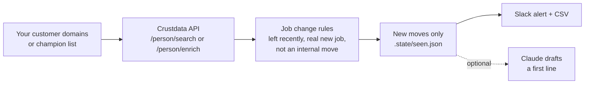

# Champion Job Change Tracker (Open Source, Slack Alerts)

**An open-source Python tool that tells you, in Slack, when a champion at one of your customer accounts changes jobs, and where they went.**

When a champion leaves, you lose a renewal sponsor and gain a warm lead at their new company. Most teams find out months later. This tracker checks every week and posts the moves to a Slack channel, using [Crustdata](https://crustdata.com) as the people data layer ([API docs](https://docs.crustdata.com)).



## How it works



There are two modes:

| Mode | Input | Crustdata endpoint | Use it when |
|---|---|---|---|
| `discover` | Customer domains + champion titles | `POST /person/search` | You don't keep a champion list. Finds anyone with a champion-type title who left those accounts recently and started somewhere new |
| `track` | `champions.csv` (profile URL + the company your CRM has) | `POST /person/enrich` | You already know your champions. Re-checks each one and flags anyone whose current employer no longer matches your CRM |

The rules that turn raw profiles into alerts (in `tracker.py`, all unit tested):

- The old role must be at one of your domains, match a champion title, and have ended inside the window.
- The new role must be a real job. Community memberships, advisor seats, board seats and angel investments are ignored.
- Moving to another team at the same company is not a job change.
- Each move alerts once. Already-sent moves are remembered in `.state/seen.json`.

## Quickstart

Requires Python 3.9+. No dependencies for the core tool.

```bash
git clone https://github.com/mhimed-crustdata/champion-job-change-tracker
cd champion-job-change-tracker
make setup        # creates .env, then add your CRUSTDATA_API_KEY and CUSTOMER_DOMAINS
make demo         # runs discover and prints the summary, never posts to Slack
```

Then, for real alerts:

```bash
make run          # discover mode, posts new moves to SLACK_WEBHOOK_URL
make track        # track mode, reads champions.csv (see examples/champions.example.csv)
make test         # unit tests, no network
```

Run it weekly with cron (`0 8 * * 1 cd /path/to/repo && make run`) or a scheduled CI job with your keys stored as secrets.

## Configuration

All settings live in `.env` (copy from `.env.example`). Command-line flags override them.

| Variable | Default | What it does |
|---|---|---|
| `CRUSTDATA_API_KEY` | required | Your Crustdata API key. Read from the environment only, never written to disk by the tool |
| `CUSTOMER_DOMAINS` | none | Comma list of customer website domains (discover mode). `--domains customers.csv` also works with a `domain` column |
| `CHAMPION_TITLES` | `Revenue Operations,Sales Operations,Head of Sales,VP Sales` | Title keywords your champions hold |
| `SINCE_DAYS` | `90` | How far back a departure counts |
| `SLACK_WEBHOOK_URL` | empty | Slack incoming webhook. Empty means no Slack post |
| `ANTHROPIC_API_KEY` | empty | Optional. With `--draft-openers`, Claude writes a one-line congratulations note per move |
| `ANTHROPIC_MODEL` | `claude-opus-5-5` | Model for the optional Claude step |

Useful flags: `--dry-run` (never post to Slack), `--all` (include moves already alerted on), `--out DIR`, `--max-results N`.

Output files, written to `out/`:

- `moves.csv`: one row per move (name, profile URL, old company and title, new company, title, start month, new company size).
- `moves.json`: the same rows plus a summary block.

Both files contain personal data. `out/` and `.state/` are in `.gitignore`.

## Example output

A real run on 2026-10-18 against the live API, discover mode, with a sample watchlist of 25 well-known software companies, seven champion titles and a 120-day window. Names, titles and companies of individuals are left out on purpose. Aggregated from `out/moves.json`:

```json
{
 "moves": 15,
 "left_without_new_role": 0,
 "accounts_with_a_move": "11 of 25",
 "old_role": {"RevOps / Sales ops / GTM ops": 8, "Sales leadership": 4, "Marketing ops": 3},
 "new_company_size": {"1001-5000": 7, "51-200": 3, "201-500": 2, "11-50": 1, "501-1000": 1, "unknown": 1},
 "new_role_started": {"2026-07": 4, "2026-08": 8, "2026-09": 3}
}
```

Track mode was then run on 7 profiles: 6 of the people found above (with their old company as the "CRM" value) and 1 control who had not moved. Result: 6 of 6 moves confirmed through `/person/enrich`, and the control was correctly not flagged.

What the Slack alert looks like (redacted):

```text
:rotating_light: 15 champion job change(s)
• [Name] ([Director-level RevOps title] at [Customer account]) is now [Senior Director title] at [New company] since [YYYY-MM-DD] profile
• [Name] ([Sales leader title] at [Customer account]) is now [Head of Sales] at [New company] since [YYYY-MM-DD] profile
…and 13 more in out/moves.csv
```

## How to build a champion job change tracker agent

You can run this repo as is, or use it as the base for an agent:

1. **Pick the signal.** A champion is a person, not a company. Store a stable person key (profile URL or Crustdata person ID) next to the account in your CRM, not only their email.
2. **Choose the data call.** If you have the people, re-check them with `POST /person/enrich` (up to 25 profile URLs per request). If you only have accounts, search with `POST /person/search` on `experience.employment_details.past.company_website_domain` plus a title filter and a recent `current.start_date`.
3. **Write the rules in code, not in a prompt.** Ended-role date, real-job check and same-company check are deterministic. Keep them testable (`tests/test_tracker.py`).
4. **Remember what you sent.** Alert only on new moves (`.state/seen.json` here, a CRM field in production).
5. **Use the model only for language.** The optional Claude step writes one opener per move. It never decides who moved.
6. **Close the loop.** Send the alert where reps already work (Slack), create a task or a new contact at the new company in your CRM, and route the old account to its owner as a renewal risk.

To turn it into a chat agent, expose `discover()` and `track()` as tools and let Claude call them, for example with the Crustdata MCP server (see the [Crustdata docs](https://docs.crustdata.com)).

## FAQ

**What is a champion job change tracker?**
A tool that watches the people who bought or backed your product and tells you when they change employer, so you can keep the old account and open the new one.

**How often does it check?**
As often as you run it. Weekly is a good default. How fresh each profile is depends on when it was last refreshed; see Crustdata's [data updates page](https://docs.crustdata.com/general/data-updates).

**Do I need a list of champions?**
No. `discover` mode only needs your customer domains and the titles your champions usually hold. If you do have a list, `track` mode is more precise.

**Does it send messages to anyone?**
No. It only posts to your own Slack webhook, and only when `SLACK_WEBHOOK_URL` is set and `--dry-run` is off.

**Is Claude required?**
No. Claude is optional and only drafts an opener line. Without `ANTHROPIC_API_KEY` the tool runs the same.

**Which Crustdata endpoints does it use?**
`POST /person/search` (discover) and `POST /person/enrich` (track), on API version `2025-11-01`. Details in the [Crustdata API docs](https://docs.crustdata.com).

**Where is my API key stored?**
Only in your environment or your local `.env`, which is git-ignored. The tool sends it in the `authorization` header to `api.crustdata.com` and nowhere else.

## Project layout

```text
tracker.py          # the workflow: discover, track, rules, output
crustdata_api.py    # tiny Crustdata client (stdlib only)
notify.py           # optional Slack + Claude
tests/              # unit tests, no network
examples/           # sample champions.csv
```

## License

MIT. See [LICENSE](LICENSE). Data layer: [Crustdata](https://crustdata.com) ([docs](https://docs.crustdata.com)).
